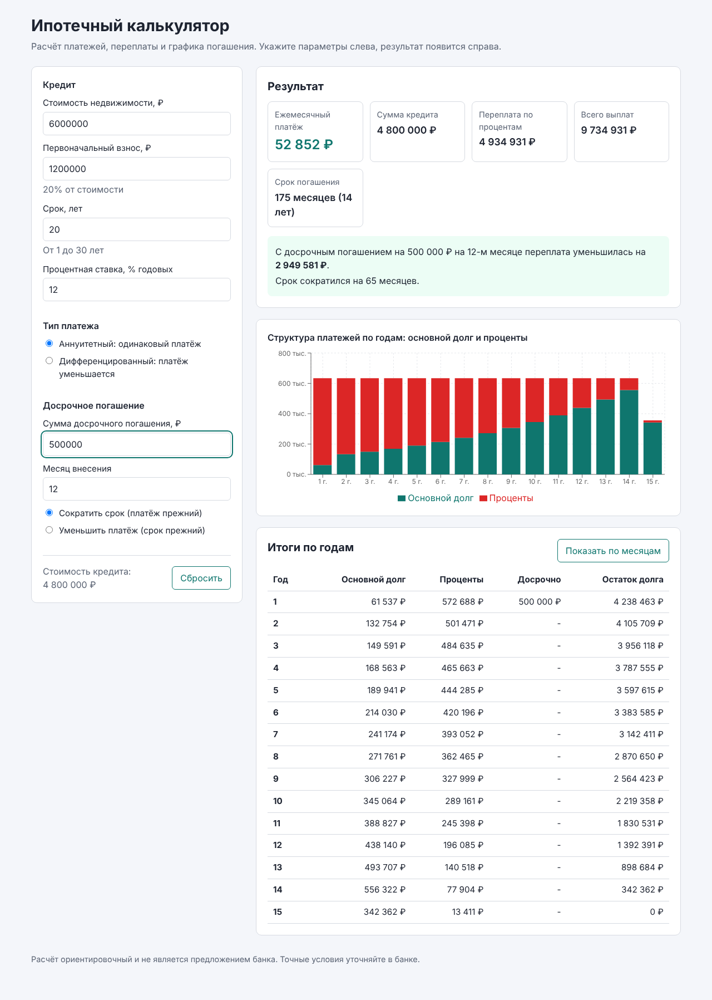

# Ипотечный калькулятор

Веб-приложение для расчёта ипотеки: ежемесячные платежи, переплата, досрочное погашение и подробный график. Аннуитетные и дифференцированные платежи. Параметры хранятся в адресной строке, поэтому расчёт можно сохранить закладкой или отправить ссылкой.



*Рисунок 1. Расчёт кредита 4,8 млн ₽ на 20 лет под 12% годовых с досрочным погашением 500 000 ₽ на 12-м месяце. Срок сокращён, платёж сохранён.*

**Demo:** https://kostiuchenkoav.github.io/mortgage-calculator/

## Возможности

- Два типа платежа: аннуитетный (одинаковый платёж) и дифференцированный (платёж уменьшается).
- Досрочное погашение с двумя режимами: сокращение срока или уменьшение платежа.
- Итоги: платёж, сумма кредита, переплата по процентам, общая выплата и срок погашения.
- Диаграмма структуры платежей по годам. Загружается отдельно, поэтому не замедляет открытие страницы.
- Таблица по годам по умолчанию и помесячный график по кнопке.
- Проверка ввода с понятными сообщениями. Расчёт пересчитывается сразу, без кнопки.
- Параметры сохраняются в адресной строке и восстанавливаются при открытии ссылки.
- Адаптивная вёрстка: на телефоне форма и результаты идут друг под другом.

## Стек

- React 18 и TypeScript в строгом режиме
- Vite 5 для сборки и разработки
- Recharts для диаграммы (подключается через `React.lazy`)
- Vitest, jsdom и Testing Library для тестов

## Формулы

Ставка переводится в месячную: `r = годовая ставка / 12 / 100`. Срок в месяцах: `n`.

- **Аннуитет:** `платёж = P · r / (1 − (1 + r)^(−n))`. Сначала гасятся проценты, остальное идёт в основной долг.
- **Дифференцированный:** основной долг делится на `n` равных частей, проценты считаются на остаток.
- **Досрочное погашение** уменьшает остаток. В режиме «сократить срок» платёж сохраняется, и кредит закрывается раньше. В режиме «уменьшить платёж» срок сохраняется, а платёж пересчитывается на оставшийся срок.

Досрочное погашение доступно для аннуитетных платежей. Расчёт ведётся помесячно, округление только для отображения. Итоги ориентировочные: комиссии, страховка и условия конкретного банка не учитываются.

## Запуск

Требуется Node.js 20 или новее.

```bash
npm install
npm run dev        # режим разработки
npm test           # тесты
npm run typecheck  # проверка типов
npm run build      # продакшн-сборка в dist/
npm run preview    # просмотр сборки
```

## Структура

```
src/
├── lib/                 # чистая логика, без React
│   ├── mortgage.ts      # расчёт графика, досрочное погашение, сводка по годам
│   ├── validation.ts    # значения по умолчанию, проверка ввода
│   ├── url.ts           # перевод параметров в адресную строку и обратно
│   └── format.ts        # форматирование рублей, процентов и сроков
├── components/
│   ├── LoanForm.tsx     # форма параметров
│   ├── ResultSummary.tsx# итоговые показатели
│   ├── PaymentChart.tsx # диаграмма (ленивая загрузка)
│   └── ScheduleTable.tsx# таблица по годам и по месяцам
├── App.tsx              # связывает форму, расчёт и вывод
└── App.test.tsx         # интеграционные тесты интерфейса
```

Логика расчёта отделена от интерфейса и покрыта модульными тестами (формулы, проверка ввода, адресная строка, форматирование). Интеграционные тесты проверяют сценарии пользователя: пересчёт, переключение таблицы, ошибки ввода и восстановление из ссылки. Всего 32 теста.

## Деплой

Сборка публикуется на GitHub Pages через GitHub Actions (`.github/workflows/pages.yml`) при каждом пуске в `main`. Проверки типов, тесты и сборка запускаются в `.github/workflows/ci.yml` для каждого пуска и pull request.

## Лицензия

[MIT](LICENSE)
